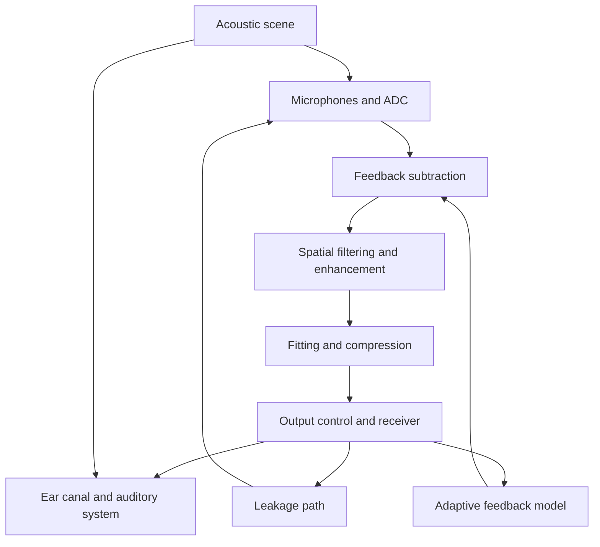

# CONCEPTS — From two ears to a hearing-aid research system

**Learning guide for Hearing Auditory Lab, v0.5 · 26 November 2026.**

Start here to understand the system; use [README.md](README.md) for installation and [Skills.md](Skills.md) for reproduction. Equations below explain the implemented ideas, not a clinical fitting prescription. References distinguish original papers, official standards, and implementation documentation. Standards summaries describe their published scope; they are not substitutes for the normative documents or compliance test limits.

## Learning route

| Stage | Learn | Demonstrate your understanding |
|---|---|---|
| 1. Acoustics and biology | Pressure, levels, cochlea, audiogram | Explain why adding 40 dB everywhere is inappropriate |
| 2. Hearing-aid architecture | Microphones, fitting, compression, receiver, feedback | Draw both the forward path and acoustic feedback loop |
| 3. Spatial hearing | ITD, ILD, HRTF, binaural signals | Explain the two-microphone front/back ambiguity |
| 4. Array processing | STFT, covariance, localization, DS, MVDR | Separate target direction from target identity |
| 5. Neural processing | Masks, PSD matrices, neural MVDR, causality | Explain why a fast offline model can still have unacceptable latency |
| 6. Evaluation | Signal metrics, auditory models, real-ear verification, outcomes | Design a comparison that cannot win merely by making everything quieter |
| 7. Research | Controlled ablations, uncertainty, deployment | Identify the missing evidence before claiming practical benefit |

Read each stage, run its exercise, then inspect the linked code. There is no need to understand the neural model before learning how the reference microphone behaves.

## 1. Sound levels: the units must survive the entire pipeline

Sound pressure is a physical quantity in pascals. Sound pressure level is

$$L_p=20\log_{10}(p_{\mathrm{rms}}/(20\,\mu\mathrm{Pa})).$$

Thus 1 Pa RMS is approximately 94 dB SPL. **dBFS** refers to digital full scale, whereas **dB HL** expresses an audiometric threshold relative to frequency- and transducer-specific reference thresholds. They are not interchangeable. A threshold of 40 dB HL at 4 kHz is neither a digital gain setting nor a statement that every 4 kHz sound must receive 40 dB gain. Audiometry and hearing-aid verification use different reference conditions [R1, R4, S3].

In our research code, `equiv_0db_spl=100` defines an assumed conversion between digital RMS and SPL for the auditory model. In the room experiments, the target at the left reference microphone is scaled to 65 dB SPL under that convention. This does **not** calibrate your headphones: their actual SPL depends on the DAC, amplifier, headphone sensitivity, fit, and volume.

**Exercise:** Calculate the RMS amplitude for 65 dB SPL when digital RMS 1 corresponds to 100 dB SPL. Answer: $10^{(65-100)/20}\approx0.0178$. Trace this calculation in `research/prepare_spatial_scenes.py`. Change a software playback volume and explain why the stored HASPI result does not change.

## 2. What the auditory system does, and what can fail

The outer ear and canal collect and spectrally shape sound. The eardrum and middle-ear bones convey vibration to the cochlea. Motion along the basilar membrane is frequency dependent; hair-cell activity ultimately drives auditory-nerve signals. The brain interprets these patterns across time and both ears [R1].

A useful distinction is **conductive** loss, involving transmission through the outer/middle ear, versus **sensorineural** loss, involving inner-ear or neural function; both can coexist. Aging, noise exposure, disease, and some medicines can contribute to sensorineural damage. Hearing aids increase and reshape the acoustic signal available to the remaining auditory system; they do not regenerate damaged sensory cells [R2].

An audiogram measures detection thresholds. It does not fully specify speech-in-noise ability, frequency selectivity, temporal processing, cognition, or sound tolerance. Reduced audibility can coexist with reduced usable loudness range and poorer discrimination. Consequently, two people with similar thresholds need not experience the same processed audio [R3, R4].

Our original browser page illustrates frequency-dependent attenuation. It is **not an audio recording of another person's hearing**. The separate MSBG examples model more mechanisms, but remain model outputs. Listening to either through normal ears does not reproduce an individual's complete perception.

**Exercise:** Compare the same audiogram with slow and fast compression. Predict differences before listening. Explain why “the simulated loss sounds muffled” cannot validate a clinical simulator.

## 3. What is physically inside a hearing aid?

The exact design differs across behind-the-ear, receiver-in-canal, and in-ear devices. The following is a functional engineering map, not a claim that every device has every feature [R2, R4].

| Component | Why it exists | Main engineering constraint | In this lab |
|---|---|---|---|
| One or more microphones | Convert pressure to signals; multiple microphones enable spatial processing | Self-noise, matching, wind, placement | Simulated; optional browser microphone in original lab |
| Analog front end and ADC | Set usable electrical range and digitize input | Noise floor, clipping, sample clock | Not modeled as a physical circuit |
| DSP / low-power processor | Filtering, detection, gain control, enhancement | Worst-case time, memory, energy | JavaScript DSP and WASM; offline Python |
| Filter bank and fitting gains | Allocate amplification by frequency and input level | Audibility versus loudness/distortion | Broad-band NAL-R approximation live; exact FIR offline |
| Compression and output control | Fit an input range into the listener's usable range | Attack/release artifacts, maximum output | Educational WDRC and digital ceiling |
| DAC, output amplifier and receiver | Produce sound in the ear canal; “receiver” means miniature loudspeaker | Bandwidth, distortion, acoustic load | Headphones act as playback endpoint |
| Dome/earmold, vent and acoustic tube | Couple receiver to ear; control leakage and occlusion | Individual anatomy and feedback | No physical fitting model |
| Battery and power management | Supply continuous wearable operation | Runtime, charging, peak power | No battery measurements |
| Wireless/telecoil and optional sensors | External audio, control, bilateral communication or motion information | Synchronization, radio cost, delay | Not implemented |

A conceptual signal graph has both a forward route and a feedback loop:

The direct acoustic route matters for open fittings. Different products reorder or combine processing blocks. This diagram teaches the dependencies; it is not our software's exact call graph.

## 4. Which frequencies should be amplified?

There is no universal “best frequency band” or gain curve that maximizes benefit for everyone. Gain depends on the audiogram, input level, available headroom, fitting method, acoustic coupling, and listener needs. High-frequency speech information can matter without implying that unlimited high-frequency gain is beneficial.

**NAL-R** is a historical linear prescription that makes a useful transparent baseline [R5]. **NAL-NL2** is a nonlinear prescription based on intelligibility and loudness modeling with empirical adjustments [R6]. Our NAL-R target plus an educational compressor is **not NAL-NL2**. We have not implemented a validated clinical nonlinear fitting prescription.

Our six displayed threshold frequencies are 250, 500, 1000, 2000, 4000 and 6000 Hz. Read `dist/dsp.js` to see how target gains are realized with broad overlapping bands. Their frequency response is only an approximation to the desired targets. `clarity.enhancer.nalr.NALR` supplies the exact FIR baseline in the offline study.

**Exercise:** Set only the 4 kHz threshold higher. Inspect which nearby frequencies change in the broad filter-bank realization. Compare the target gain values with the actual transfer function, rather than assuming that a slider changes one isolated frequency bin.

## 5. Wide dynamic-range compression (WDRC)

A simple static example above a knee $T$ is

$$L_{out}=T+G_0+(L_{in}-T)/CR.$$

Here $G_0$ is the gain at the knee and $CR>1$ is the compression ratio. With $CR=2$, a 20 dB input increase gives a 10 dB output increase in that region. The actual gain is $L_{out}-L_{in}$, so stronger inputs receive less gain. A running envelope detector, attack time and release time make this a dynamic system [R3].

This is **dynamic-range compression**, not MP3-like data compression. Frequency channels may use different settings. Fast gain changes can alter speech envelopes; independent left/right gain changes can alter interaural level differences. Compression and noise reduction must be assessed together because changing noise also changes the envelope that drives gain.

**Code exercise:** Follow an input block through the band filters, envelope update, gain calculation and output ceiling in `dist/dsp.js`. Compare steady tones and speech: a tone's steady gain does not describe the transient response to speech. The array experiment is a separate enhancement page; it does not run this live fitting chain.

## 6. Feedback cancellation versus automotive echo cancellation

In automotive AEC, a far-end playback reference helps estimate the loudspeaker-to-microphone echo path. In an acoustic hearing-aid feedback loop, the receiver output leaks back to the hearing-aid microphone. The output is already derived from the wanted input, so correlation can bias adaptation. A hand near the ear or a changed fitting can change the path [R7].

In a simplified model,

$$x(n)=s(n)+(f*y)(n),\qquad e(n)=x(n)-(\hat f*y)(n).$$

The adaptive filter estimates feedback path $f$; stable usable gain and artifacts both matter. A noise suppressor does not automatically solve this closed-loop problem. Telephone/streaming products may additionally need other echo-control functions, depending on the signal routes.

**Lab boundary:** Neither the live array page nor the hearing-loss page implements adaptive acoustic feedback cancellation or telephony AEC. Headphone playback avoids the intended acoustic loop in ordinary demo use; it does not demonstrate feedback stability. A future experiment must explicitly simulate a time-varying receiver-to-microphone path and measure additional stable gain as well as speech/music distortion.

## 7. Why two ears help: ITD, ILD and HRTF

An **interaural time difference (ITD)** describes relative arrival timing. An **interaural level difference (ILD)** describes relative levels. A **head-related transfer function (HRTF)** describes direction-dependent filtering from a source to an ear, including head and pinna effects; its time-domain form is an HRIR. Adding a room gives a binaural room response, not merely a free-field HRTF [R8].

For a simple two-microphone far-field model with spacing $d$, a convention-dependent delay is $\tau=d\sin\theta/c$. At $d=0.18$ m and $c=343$ m/s, the maximum magnitude is about 0.525 ms. A given delay can correspond to both front and rear directions. Real pinnae, head motion, more microphones and additional observations can supply information absent from that ideal model.

The original lab convolves sources with measured MIT KEMAR ear HRIRs. The array page instead uses four ideal microphone mixtures, without head scattering. Ear HRIRs are **not automatically transfer functions to behind-the-ear microphone positions**. Combining the two pages realistically requires an appropriate multichannel head/room measurement set.

**Exercise:** In the array page select two localization microphones, full-circle search, and compare 30° with 150°. Then apply a ±90° sector around 0°. The ambiguity is removed by your prior assumption, not by newly observed acoustic information. A low peak contrast exposes uncertainty; it is not a probability.

## 8. From microphone samples to spatial statistics

At time-frequency bin $(k,t)$, stack microphone observations into a complex vector:

$$\mathbf{x}_{kt}=\mathbf{d}_k s_{kt}+\mathbf{n}_{kt}.$$

The steering vector $\mathbf d_k$ captures relative phase and amplitude for a target. The noise spatial covariance is $\mathbf R_{n,k}=E[\mathbf n\mathbf n^H]$. Its off-diagonal terms encode relationships between microphones. The superscript $H$ means conjugate transpose.

The array code uses a 512-sample STFT at 48 kHz and a 128-sample hop. Its bins are 93.75 Hz apart. A window/hop choice trades frequency resolution, responsiveness, computation and buffering. Perfect overlap-add reconstruction requires compatible windows and scaling; the unit tests check the actual streaming path.

Read `dist/array-dsp.js` in this order: fractional delays, FFT, `Scene`, `Beamformer`, calibration, weights, synthesis. Notice which objects persist across callbacks. Recreating filters or model state on every block changes both the signal and the timing measurements.

## 9. Localization: DOA is a measurement, target selection is a decision

GCC-PHAT forms a phase-normalized cross spectrum between microphones. SRP-PHAT scores candidate directions by how well the observed pairwise phases agree with predicted delays, then chooses a peak [R9]. Our implementation searches a 5° horizontal grid, combines six pairs for four microphones, smooths cross spectra with a 100 ms time constant, and updates every 21.33 ms.

The estimator sees microphone spectra, not clean source stems. Its search-sector center is a user prior. A peak may belong to noise or another speaker. `dist/localization.js` implements estimation; `dist/array-engine.js` decides whether to apply the estimate. A peak-contrast gate of 0.02 is an explicit engineering choice, not a trained confidence model.

For a robot, **detect → localize → select/associate → track → steer** is one useful architecture. An application may select whoever is speaking, a visual face, a wake-word source, or an enrolled speaker. A tracker needs identity association and motion/uncertainty handling; smoothing alone is not such a tracker. Head-relative directions also need a pose transform to remain stable in world coordinates.

Drones add rotor noise, wind, vibration and changing orientation. Motor-speed or inertial references can be useful extra observations. DREGON supplies real drone-related recordings; LOCATA supplies localization recordings including robot-head and hearing-aid arrays [R10, R11]. Neither dataset has been evaluated in this release. Our synthetic Gaussian masker is not a validated drone-noise model.

## 10. Delay-and-sum and MVDR

A normalized delay-and-sum baseline is $\mathbf w=\mathbf d/(\mathbf d^H\mathbf d)$, with output $y=\mathbf w^H\mathbf x$. It aligns a selected direction, then combines channels. Signals from other directions need not align.

MVDR minimizes output noise power while constraining the desired steering response:

$$\min_{\mathbf w}\mathbf w^H\mathbf R_n\mathbf w\quad\text{subject to}\quad\mathbf w^H\mathbf d=1,$$

$$\mathbf w=\frac{\mathbf R_n^{-1}\mathbf d}{\mathbf d^H\mathbf R_n^{-1}\mathbf d}.$$

The code uses a linear solve and diagonal loading rather than explicitly inverting matrices. Loading improves numerical robustness and limits aggressive nulling. Its value is a design parameter with a distortion/noise tradeoff [R12, R13].

In our baseline, a one-second **target-muted calibration** provides noise statistics, which are then frozen. This is privileged calibration, though the filter receives only microphone samples during it. The known-direction baseline also receives the simulator's target direction. The estimated-direction version removes that steering privilege but keeps the same calibration advantage.

**Why MVDR can look impressive:** coherent stationary interference, accurate steering and useful calibration favor spatial cancellation. Colocated target/noise, steering mismatch, movement, reverberation, microphone mismatch and diffuse noise challenge those assumptions. A quieter output may mean that the target was suppressed too.

**Exercise:** Compare correct steering with a 20° error, first with separated sources, then colocated ones. Check target-only distortion and level change where available, not only output SNR. The constraint protects the assumed steering vector; it cannot protect an arbitrary mismatched target.

## 11. Binaural output is more than two channels

A mono beamformer copied identically into both ears destroys interaural differences. Our classical path applies the target steering response of reference microphones 0 and 2 to a common beamformer output. This aims to preserve the modeled target relationship. It also gives the residual noise that relationship, so it is **not full preservation of the original auditory scene**.

Our offline neural MVDR computes separate reference-ear weights. Our RNNoise postfilter uses two independent states. Neither choice alone guarantees preservation of target and interferer spatial cues. This motivates ILD/ITD diagnostics and later binaural-constrained algorithms.

**Exercise:** Compare noise reduction against absolute ILD and ITD error on the evaluation page. Explain why a single broadband cue error can hide a frequency-specific failure. The displayed cue errors compare mixture outputs with target-only ear images; they are engineering diagnostics, not measured human localization errors.

## 12. What is a neural beamformer?

Three different methods must be distinguished:

| Method | What the network produces | Spatial operation | This release |
|---|---|---|---|
| Neural postfilter | Gains or enhanced mono speech | Separate classical beamformer first | Live RNNoise after DS/MVDR |
| Neural mask-based beamformer | Speech/noise masks or statistics | Analytical multichannel weights | Offline MetricGAN+ proxy + Souden MVDR |
| Direct neural multichannel processor | Waveforms, filters or spatial features | Learned architecture | Not implemented |

A mask-based system can estimate covariance without an explicit angle:

$$\hat{\mathbf R}_{s,k}=\frac{\sum_t m_{kt}\mathbf x_{kt}\mathbf x_{kt}^H}{\sum_t m_{kt}+\epsilon}.$$

A noise mask supplies $\hat{\mathbf R}_n$. A Souden-style reference-channel MVDR uses

$$\mathbf w_{k,r}=\frac{\hat{\mathbf R}_{n,k}^{-1}\hat{\mathbf R}_{s,k}}{\operatorname{tr}(\hat{\mathbf R}_{n,k}^{-1}\hat{\mathbf R}_{s,k})}\mathbf u_r.$$

Thus explicit DOA estimation is **optional**, although deciding which source counts as target remains essential [R13, R14].

Our network is a pinned pretrained SpeechBrain MetricGAN+ enhancer, originally single-channel. Its output acts on log magnitudes. We recover estimated linear magnitudes, convert their ratio to a bounded power proxy, then estimate multichannel covariance and two reference-ear weights. This is a documented experimental hybrid, not reproduction of a published multichannel model's reported scores [R15, R16].

The model has a bidirectional recurrent network and the experiment uses whole-utterance covariance. It is **offline and noncausal**. A low RTF cannot make it a live hearing-aid algorithm. Inspect `research/neural_mvdr.py`; compare its preprocessing against the pinned model configuration before changing it. A learned speech/noise proxy is also not a guaranteed selector of one speaker among several.

## 13. Real-time factor, latency, memory and energy

For a 128-sample block at 48 kHz, the callback budget is 2.667 ms. Component execution time is the CPU time spent doing work. Algorithmic delay is the signal's buffering/look-ahead delay. End-to-end acoustic latency additionally includes converters, driver/device queues and propagation.

The measured array path has 512 samples of alignment delay, or 10.667 ms. The pinned RNNoise adapter adds 30 ms, giving 40.667 ms before device buffering. Localization shares the analysis spectrum and adds no audio queue, but its 100 ms smoothing creates **control response lag**. These are three different time quantities.

$$RTF=\frac{\text{processing time}}{\text{audio duration}}.$$

RTF below 1 describes average throughput. Inspect p95/p99/max execution and missed deadlines too. The demo reports typed-array bytes and reserved WASM heap separately; neither is whole-process active memory. Parameter bytes exclude activations and workspaces. Desktop CPU results do not establish wearable battery life; energy requires power measurements on the intended device.

**Exercise:** Explain how RTF 0.1, a 40 ms signal delay, and an occasional missed 2.667 ms callback deadline can all be true. In an open fitting, derive the comb spacing $1/\tau$ for equal-level direct and delayed copies: 10 ms gives 100 Hz spacing.

## 14. Quality assessment: the equivalent of your ITU-T workflow

The closest analogy is a **measurement stack**, rather than one replacement for ITU-T.

| Question | Automotive telephony reference | Hearing-aid counterpart | Our current evidence |
|---|---|---|---|
| Does the system meet defined electroacoustic requirements? | ITU-T P.1100 narrowband / P.1110 wideband vehicle hands-free testing | IEC 60118-0:2022: coupler/ear-simulator performance measurements | DSP and simulation tests only |
| How does adaptive processing respond to speech-like input? | Appropriate P-series signals and procedures | IEC 60118-15:2012: ISTS-based characterization | Speech clips; not a compliant ISTS test |
| Is the output appropriate in this particular ear? | Vehicle/transducer acoustic measurement configuration | IEC 61669:2015 + AMD1:2025: real-ear acoustic measurements | Not performed |
| Is the fitting process systematic? | Product validation and service procedures | ISO 21388-1:2026 fitting management | Educational fitting baseline only |
| Can objective processing quality be predicted? | ITU-T P.863, within its application conditions | Hearing-loss-aware HASPI/HASQI research metrics | Offline per-ear HASPI v2 and HASQI v2 |
| Does the person benefit? | Listening/conversation studies | Aided speech-in-noise, comfort, preference, spatial and daily-life outcomes | No participant study |

Sources: [S1–S6], [R4, R17]. ISO 21388-1:2026 replaces ISO 21388:2020. IEC 60118-0:2022 incorporates the earlier production quality-control scope of IEC 60118-7. Use the exact applicable edition and complete test configuration when planning compliance work. We have checked the official catalog scopes; we have not run or claimed a certified standards test.

Bench measurements can examine gain/frequency response, output, distortion, internal noise and electrical consumption. A coupler supplies a repeatable acoustic load; it is not an individual ear. Real-ear verification uses probe-microphone measurements to check actual ear-canal output against fitting targets. Verification asks whether the device delivers the intended response; validation asks whether the listener benefits [S1, S3, R4].

For clinical outcomes, use an appropriate validated speech-in-noise protocol and language, controlled presentation levels, documented aided/unaided conditions, and listener-centered measures. Do not invent a universal pass threshold from one speech score. The guide does not replace an audiologist's fitting and assessment process.

## 15. What each metric can and cannot tell us

| Metric | Meaning | Main trap |
|---|---|---|
| Output SNR / SNR improvement | Target energy relative to residual noise | Needs a valid decomposition; target can be attenuated |
| SI-SDR | Waveform agreement after optimal scalar projection | Scale invariance hides gain loss; report level change too |
| Target-only SI-SDR / level change | Distortion introduced by a fixed linear filter | Separate nonlinear runs do not decompose a nonlinear mixture output |
| HASPI v2 | Auditory-model-based speech intelligibility prediction with audiogram | Not a directly measured word score for this listener |
| HASQI v2 | Auditory-model-based speech quality prediction | Reference/equalization/level conventions matter |
| ILD / ITD error | Level/timing relationship changes between outputs | Broadband summary is not human spatial performance |
| DOA angular error | Difference between estimated and true source direction | Identity mistakes and missing detections need separate reporting |
| Runtime and memory | Cost of the implementation on measured hardware | Does not establish quality, battery life or wearable suitability |

For SI-SDR, after mean removal, $\hat s=\langle y,s\rangle s/\|s\|^2$ and $10\log_{10}(\|\hat s\|^2/\|y-\hat s\|^2)$ measures projected signal versus residual [R18]. An output $0.01s$ can have an excellent SI-SDR while being 40 dB quieter: this is why the level column exists.

HASPI/HASQI incorporate an auditory model parameterized by hearing loss and compare a processed signal with a reference. They predict different perceptual attributes and are not interchangeable [R17]. Our code records the audiogram, assumed SPL conversion, metric versions and HASQI equalization flag. It scores the actual processed waveform, not a rendered chart or a neural model card's published number.

## 16. Read this release's evaluations correctly

The expanded experiment uses four LibriSpeech test-clean speakers held out from our earlier demo development: 1320, 5639, 260 and 7729. There are two requested room conditions (anechoic and 0.3 s RT60), two left-reference input SNRs (0 and 5 dB), and six methods: **16 scenes × 6 = 96 rows** when complete. Each utterance supplies its first three seconds. Requested RT60 is not an independently measured room decay.

Each speaker has one assigned target/masker geometry. Speaker and geometry are therefore confounded in this small design; these are four independent speaker examples, not 96 independent subjects. The reference is the **reverberant target image at each reference microphone**, not dry speech. This tests noise enhancement without requiring perfect dereverberation.

All methods receive the same downstream exact NAL-R FIR, sloping audiogram and digital ceiling for hearing-metric scoring. Fixed DSP/FIR delays are removed offline for comparison, not eliminated from the device. The first 0.2 s is excluded from quality scoring. Model inference never receives clean stems; the evaluator does. Classical methods have a noise-only calibration advantage, whereas neural MVDR has future context. This is an exploratory comparison with disclosed information access, not a fair causal leaderboard.

Open `dist/evals.html`, then inspect `dist/perceptual-evaluation.json` and `research/evaluate_perception.py`. Compare by room and SNR before pooling. The dashboard averages ears within each scene and conditions within each speaker before averaging speakers. Its displayed speaker spread is descriptive, not a reliable population confidence interval from four people.

## 17. Experiments to make the whole system understandable

1. **Audibility:** change one audiogram band; inspect target versus realized gain. Explain the difference between hearing-loss illustration and fitted output.
2. **Dynamic range:** compare compression ratios and time constants at fixed input/output settings; listen for envelope changes.
3. **Spatial ambiguity:** compare two/four localization microphones, front/rear positions and sector priors; inspect contrast and errors.
4. **Steering robustness:** compare known and estimated steering; try a loud interferer and describe which source the estimator follows.
5. **Noise suppression versus distortion:** compare DS, MVDR and RNNoise with target-only metrics where valid and listening clips at common gain.
6. **Reverberation:** compare the same speaker/SNR across room settings; distinguish direct-path steering mismatch from suppression quality.
7. **Neural masks:** compare the offline neural hybrid against known-steering MVDR; document its future-context advantage and any quality regression.
8. **Deployment:** inspect latency, deadline overruns and memory; propose what must change before testing a wearable implementation.

For a stronger next study, cross speakers with multiple geometries, use longer utterances, add competing speech and diffuse/moving noise, vary audiograms, measure actual room responses, and test real array recordings. Add target association before claiming speaker tracking. Evaluate streaming neural models with persistent state and explicit look-ahead. Add feedback-loop experiments, calibrated hardware measurements and appropriately designed listener studies before claiming hearing-aid benefit.

## 18. Reading list and code map

**Biology and fitting**

- **[R1]** NIDCD, [How Do We Hear?](https://www.nidcd.nih.gov/health/how-do-we-hear). Start with the physical-to-neural pathway.
- **[R2]** NIDCD, [Hearing Aids](https://www.nidcd.nih.gov/health/hearing-aids). Basic components, indications and limits.
- **[R3]** Kates (2005), *Principles of Digital Dynamic-Range Compression*, [doi:10.1177/108471380500900202](https://doi.org/10.1177/108471380500900202). Read alongside `dist/dsp.js`.
- **[R4]** ASHA, [Hearing Aids for Adults](https://www.asha.org/practice-portal/professional-issues/hearing-aids-for-adults/). Assessment, verification and validation.
- **[R5]** Byrne & Dillon (1986), *The National Acoustic Laboratories' (NAL) new procedure for selecting the gain and frequency response of a hearing aid*, [doi:10.1097/00003446-198608000-00007](https://doi.org/10.1097/00003446-198608000-00007).
- **[R6]** Keidser et al. (2011), *The NAL-NL2 Prescription Procedure*, [doi:10.4081/audiores.2011.e24](https://doi.org/10.4081/audiores.2011.e24); [full text](https://pmc.ncbi.nlm.nih.gov/articles/PMC4627149/).
- **[R7]** Spriet, Rombouts, Moonen & Wouters (2006), *Adaptive feedback cancellation in hearing aids*, [author manuscript](https://ftp.esat.kuleuven.be/pub/SISTA/spriet/reports/05-243.pdf). Follow the closed-loop identification problem.

**Spatial and neural processing**

- **[R8]** Gardner & Martin, [MIT KEMAR HRTF measurements](https://sound.media.mit.edu/resources/KEMAR.html). The original lab's spatial data source.
- **[R9]** SpeechBrain, [Multi-microphone beamforming tutorial](https://speechbrain.readthedocs.io/en/stable/tutorials/preprocessing/multi-microphone-beamforming.html). Implementation reference for GCC-PHAT, SRP-PHAT and beamforming; compare `dist/localization.js`.
- **[R10]** [LOCATA corpus](https://www.locata.lms.tf.fau.de/corpus/). Real localization data; future validation, not current results.
- **[R11]** [DREGON dataset](https://members.loria.fr/ADeleforge/the-dregon-dataset/); associated IROS 2018 paper, [doi:10.1109/IROS.2018.8593581](https://doi.org/10.1109/IROS.2018.8593581).
- **[R12]** Capon (1969), *High-resolution frequency-wavenumber spectrum analysis*, [doi:10.1109/PROC.1969.7278](https://doi.org/10.1109/PROC.1969.7278). Classical minimum-variance background.
- **[R13]** Souden, Benesty & Affes (2010), *On Optimal Frequency-Domain Multichannel Linear Filtering for Noise Reduction*, [doi:10.1109/TASL.2009.2025790](https://doi.org/10.1109/TASL.2009.2025790); [TorchAudio MVDR tutorial](https://docs.pytorch.org/audio/stable/tutorials/mvdr_tutorial.html). The tutorial's oracle masks are not our learned masks.
- **[R14]** Heymann, Drude & Haeb-Umbach (2016), *Neural Network Based Spectral Mask Estimation for Acoustic Beamforming*, [author PDF](https://groups.uni-paderborn.de/nt/pubs/2016/icassp_2016_heymann_paper.pdf). Understand neural estimation plus analytical spatial filtering.
- **[R15]** Fu et al. (2021), *MetricGAN+: An Improved Version of MetricGAN for Speech Enhancement*, [arXiv:2104.03538](https://arxiv.org/abs/2104.03538).
- **[R16]** [SpeechBrain MetricGAN+ model](https://huggingface.co/speechbrain/metricgan-plus-voicebank/tree/a196ce26b3bdace6fa1d819017584bdbcce462a8), pinned revision. See `research/neural_mvdr.py` and `dist/neural-beamformer-runtime.json` for local provenance.
- **[R19]** Valin (2018), *A Hybrid DSP/Deep Learning Approach to Real-Time Full-Band Speech Enhancement*, [arXiv:1709.08243](https://arxiv.org/abs/1709.08243). RNNoise background; our bundled runtime is separately versioned in `dist/vendor/`.
- **[R20]** [RIR generator](https://github.com/audiolabs/rir-generator), image-method implementation based on Allen & Berkley (1979) and Habets' simulator. See `research/prepare_spatial_scenes.py`.

**Evaluation and standards**

- **[R17]** Kates & Arehart (2022), *An overview of the HASPI and HASQI metrics for predicting speech intelligibility and speech quality for normal hearing, hearing loss, and hearing aids*, [doi:10.1016/j.heares.2022.108608](https://doi.org/10.1016/j.heares.2022.108608); [full text](https://pmc.ncbi.nlm.nih.gov/articles/PMC10833438/). Follow its references to HASPI v2 (2021) and HASQI v2 (2014). Code: [Clarity](https://github.com/claritychallenge/clarity), pinned pyclarity 0.9.0 in this lab.
- **[R18]** Le Roux et al. (2019), *SDR — Half-baked or Well Done?*, [arXiv:1811.02508](https://arxiv.org/abs/1811.02508). Why waveform metrics and scale conventions need care.
- **[S1]** [IEC 60118-0:2022](https://webstore.iec.ch/en/publication/62974), hearing-aid performance characteristics.
- **[S2]** [IEC 60118-15:2012](https://webstore.iec.ch/en/publication/793), speech-like ISTS characterization.
- **[S3]** [IEC 61669:2015+AMD1:2025](https://webstore.iec.ch/en/publication/105114), real-ear acoustic performance.
- **[S4]** [ISO 21388-1:2026](https://www.iso.org/standard/90817.html), hearing-aid fitting management, general process.
- **[S5]** [ITU-T P.1100](https://www.itu.int/itu-t/recommendations/rec.aspx?rec=P.1100) and [P.1110](https://www.itu.int/itu-t/recommendations/rec.aspx?rec=P.1110), vehicle hands-free testing; current catalog editions checked November 2026.
- **[S6]** [ITU-T P.863](https://www.itu.int/rec/T-REC-P.863/en) and [P.863.1](https://www.itu.int/rec/T-REC-P.863.1/en), objective listening-quality prediction and application guidance. They do not replace an audiogram-aware evaluation or real-ear fitting verification.

**Code reading order:** `dist/dsp.js` → `dist/feedback.js` → `dist/hrtf.js` → `dist/array-dsp.js` → `dist/localization.js` → `dist/tracking.js` → `dist/array-engine.js` → `dist/neural.js` → `research/neural_mvdr.py` → `research/evaluate_perception.py`. Run `npm test` before modifying the DSP. Preserve original results when changing an algorithm, then regenerate both measurements and documentation.

## 19. Version 0.5: close the loop, choose the talker, fit the ears

**Feedback is a closed-loop identification problem.** With microphone signal m = x + F∗y and receiver signal y = G(m), the loop is stable while |G(f)F(f)| < 1 wherever the loop phase is a multiple of 2π. An adaptive canceller estimates F from y and subtracts F̂∗y. The difficulty is that y is a delayed, amplified copy of x, so a least-squares estimate also explains part of x and becomes biased [R7, R21]. Run panel 05 in condition D:

1. Raise the path gain without a canceller until it howls; note the bound shown in the stable-gain meter.
2. Enable **plain NLMS** with speech and no masker (set Scene SNR to quiet). Watch the misalignment climb above 0 dB: the filter is learning to predict speech, and the loop can howl at gains that were stable without it.
3. Switch to **PEM-AFC**. Prewhitening with a model of the incoming sound removes most of that correlation [R22]. Then press *Bring phone to ear* and watch it re-converge.
4. Enabling the canceller raises a 0 ms added delay to 4 ms. Drag added delay back to 0 ms and watch the misalignment rise. Explain why a loop without forward delay cannot tell feedback from incoming sound.
5. Read `dist/feedback-evaluation.json`: compare `tail_level_change_db` for the tone complex. A canceller can buy stability by cancelling wanted periodic sound.

**Direction is not identity, but continuity can stand in for it.** The 0.4 controller steered to the strongest direction. Version 0.5 lets each time-frequency bin vote, because speech energy is sparse and two talkers rarely dominate the same bin at the same time [R23]. A tracker turns the votes into persistent tracks. Lock-on keeps the track you pointed at, and a crossing guard stops a passing talker from stealing it. The speech-like policy prefers modulated sources over steady noise but cannot tell two voices apart. In array.html choose *Tracked target*, put a −5 dB stationary masker at −70° and a target at 30°, and compare with *Estimated SRP-PHAT direction*. Then switch the masker to speech and try the speech-like policy: explain why it fails.

**Individual ears.** ITD grows with head size; in a rigid-sphere model it is proportional to radius [R24]. Pinna cues shift in frequency with ear size, and scaling a generic set in frequency reduces inter-subject spectral differences [R25]. Panel 06 lets you change both parameters and load a measured set converted from SOFA. Exercise: set head width to 17 cm and predict the new ITD at 90° before reading it (KEMAR: 723 µs). Then explain why neither control can create an individual's pinna notches.

- **[R21]** van Waterschoot & Moonen (2011), *Fifty years of acoustic feedback control: state of the art and future challenges*, Proc. IEEE 99(2):288–327, [doi:10.1109/JPROC.2010.2090998](https://doi.org/10.1109/JPROC.2010.2090998).
- **[R22]** Spriet, Proudler, Moonen & Wouters (2005), *Adaptive feedback cancellation in hearing aids with linear prediction of the desired signal*, IEEE Trans. Signal Process. 53(10):3749–3763.
- **[R23]** Yilmaz & Rickard (2004), *Blind separation of speech mixtures via time-frequency masking*, IEEE Trans. Signal Process. 52(7):1830–1847.
- **[R24]** Kuhn (1977), *Model for the interaural time differences in the azimuthal plane*, J. Acoust. Soc. Am. 62(1):157–167; Algazi, Avendano & Duda (2001), *Estimation of a spherical-head model from anthropometry*, J. Audio Eng. Soc. 49(6):472–479.
- **[R25]** Middlebrooks (1999), *Individual differences in external-ear transfer functions reduced by scaling in frequency*, J. Acoust. Soc. Am. 106(3):1480–1492.

Code: `dist/feedback.js`, `dist/hrtf.js`, `dist/tracking.js`, `research/feedback-evaluation.mjs`, `research/tracking-evaluation.mjs`, `research/sofa_to_lab.py`. Method notes: `dist/feedback-method.md`, `dist/tracking-method.md`, `dist/hrtf-method.md`.
